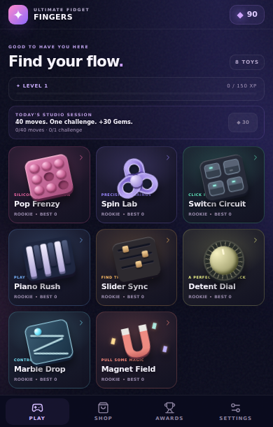
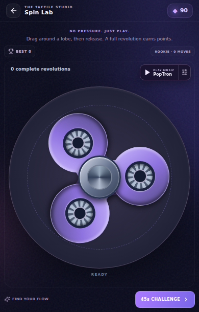
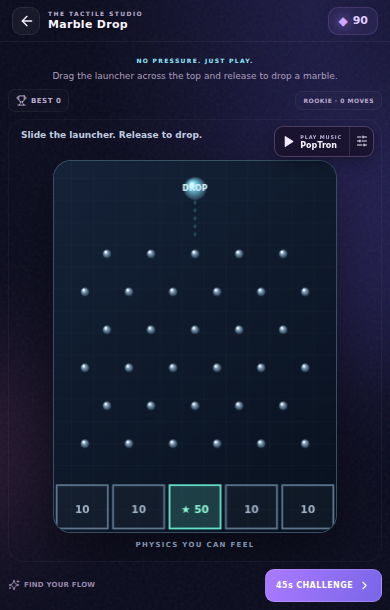

# Compact UI, larger toys and music controls

The supplied screenshots and the 32 second recording were inspected. The phone has a substantially smaller Aippy game surface than its full screen. The old root used 100dvh, and its safe-area padding, header, repeated toy title and footer used too much of that surface. Generic host text rules also made inherited game labels black.

## Implemented

- Game height follows its containing surface. Removed duplicated safe-area space inside the already contained game.
- Header 42px and navigation 46px; smaller cards, rewards, shop and settings controls.
- Three-column portrait gallery at the appropriate content width. All eight cards fit above navigation at 390×610; narrower screens use two columns and scroll normally.
- Removed the duplicated visible toy title. Enlarged the physical play surface and toys, including sliders, spinner, Pop and canvas boards.
- Slim reserved HUD strip gives each toy an explicit play/pause/retry radio button plus a shortcut to station and volume settings. It uses the shared controller and never overlaps the physical board.
- Scoped foreground colors and subtle shadows keep headings, toy names, controls and awards readable when host styles load after the game.
- Silent navigation and proper muted/zero-volume checks prevent unnecessary sound-output activation. Muting releases existing effects output. Enabled sounds/radio request ambient mixing when supported, without inventing a native SDK capability.

## Verified

- Production build and TypeScript passed: 300.71 kB JavaScript / 94.74 kB gzip; 62.90 kB CSS / 14.97 kB gzip.
- Ten economy tests, six gameplay/physics tests and both audio-boundary scripts passed.
- 62/62 compact browser checks passed at 320×520, 390×610 and 430×650 contained within a larger 844px outer viewport, with generic black host styles injected after the game styles.
- 44/44 existing browser checks passed again, including actual gestures on all toys and a real 45 second challenge.
- Production static bundle smoke test passed for touch Pop, immediate purchase, equipped station, reload persistence and one React root.
- Independent review exercised all eight freeplay toys at 844×390, 568×320 and 640×280 and all eight challenge layouts at 320×520, 568×320 and 640×280. No interactive clipping or music-control overlap was found.

The strong gallery check found a 3 pixel last-row overlap, which was fixed and retested. The first muted test incorrectly seeded storage rather than using the control; page-hide persistence correctly overwrote the seed. The final test used the actual mute setting and verified zero contexts after reload and a Pop touch.

See [compact playtest report](compact-playtest-report.md) and [audio investigation](audio-focus-investigation.md) for exact coverage and limitations. Physical Spotify coexistence is not claimed: Android's native host audio-focus policy remains outside the SDK controls found. The game-side unnecessary activations are fixed, and the available mix preference is applied. Actual hosted Aippy rendering still needs importing this update.

