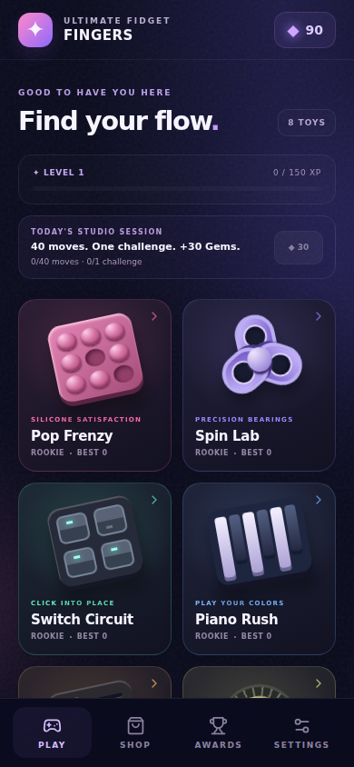
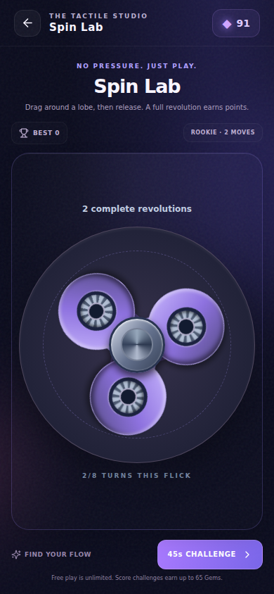
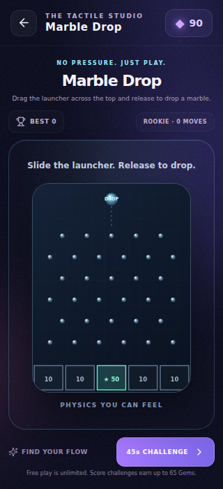
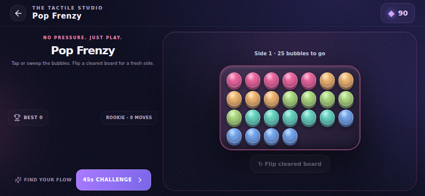

# ULTIMATE FIDGET FINGERS — integrated development checkpoint

## Outcome

Rebuilt the initial six-control prototype into eight distinctive tactile toys. Reviewed the supplied 26 original components and consolidated the strongest interaction families into a coherent lightweight arcade. The game now has procedural studio-lit toy previews, an interactive launch screen, real momentum and physics, distinct target challenges, usable rewards and visibly equipped materials/trails/backgrounds.

The complete final-goal.md target is still a quality direction, not a claim of AAA completion. This checkpoint ships a functioning local/browser game. Direct Aippy deployment and physical Android measurements remain outstanding.

## Changes

- Pop Frenzy: captured multi-touch pops, finger sweep, unique bubbles, board flip and target challenge.
- Spin Lab: angular pointer input, decaying momentum, full-revolution scores and bounded per-flick rewards.
- Switch Circuit: chunky rockers, pattern matching and immediate mechanical feedback.
- Piano Rush: layered notes, keyboard/touch chords, melody phrases and wrong-note resets.
- Slider Sync: custom faders, target bands, release accuracy and locked challenge lanes.
- Detent Dial: angular dragging, twelve snap positions and selected-frequency challenge.
- Marble Drop: launcher, peg collisions, capped live marbles, receiving cups and score-on-landing.
- Magnet Field: visible attraction, eight finite crystals per wave and release-to-recharge.
- Premium shell: procedural miniature toy art, compact navigation, daily session progress, mastery, explicit result rewards and direct freeplay/replay choices.
- Shop: studios, silicone/chrome/glass, stardust/neon/confetti, radio unlocks; previews spend nothing, purchases use catalog prices, equip is owned-only and purchases persist immediately.
- Progress: validated v2 local save with v1 migration; idempotent awards/rounds; freeplay earns up to 20 Gems/day; valid challenge rewards cap 65; a round needs 10 seconds and a positive score. Daily 40 actions + 1 valid round pays 30 once.
- Audio: shared gesture-unlocked synthesis context, capped voices, independent sound/haptic levels, Aippy native vibration routing and separate optional radio volume.
- Radio: five exact requested MP3 endpoints, station purchases, explicit playback, saved preferences, loading timeout, retry and truthful unavailable state. Selection pauses playback globally, including equips made in Shop.

## Actual verification

Baseline production build and TypeScript passed before implementation. Browser baseline confirmed three missing/broken acceptance behaviors: six rather than eight toys, empty early round earning XP, and no direct freeplay result return.

Final production build includes TypeScript and passes. Bundle measured 297.85 kB JavaScript / 94.06 kB gzip and 49.00 kB CSS / 12.27 kB gzip.

`npm test` passes ten economy/save tests, six gameplay/scoring/physics tests and two audio boundary scripts covering multiple assertions. Audio tests include one context, capped voices, native/browser haptic routing, distinct toy cues, no autoplay, rejected media playback, timeout and asynchronous media events.

Browser acceptance is documented in [playtest-report.md](playtest-report.md): real touch taps and pointer gestures, every toy, a genuine 45 second challenge, persistence, shop/awards, settings and failure handling. Portrait layouts at 320×700, 390×844, 430×932, landscape 844×390 and desktop 1280×800 were exercised. All eight toy control bounds fit narrow portrait and landscape. No uncaught browser errors were observed in the final acceptance run.

A separate production static-server smoke check actually loaded the built bundle, tapped Pop, bought/equipped an 80 Gem station, read its immediate durable save, reloaded it and verified one React root with no browser errors.

## Bugs found and fixed by testing/review

Slow centered marbles received a red→green full-board physics regression. Narrow/landscape clipped canvas cups and Pop controls were fixed with container-based sizing. An asynchronous media pause incorrectly overwrote radio failure; the controller now preserves the error and retry state. Piano keyboard input behind results could earn hidden rewards; the toy unmounts and result events are blocked. Gameplay saves now have a maximum write interval and hidden/pagehide flush, while critical transactions commit synchronously. Equipping a station outside Settings now synchronizes and pauses the live controller globally.

## Remaining work and concrete limits

- **Aippy integration:** only the original src directory was supplied, not its functioning host Vite/importer configuration. The new gameplay-only manifest preserves that host scaffold. No Aippy connector was found and the actual hosted game was not updated or verified during this checkpoint. A browser production load is not evidence of Aippy loading.
- **Physical Android:** frame timing, audible sound quality, vibration and native bridge behavior were not measured on a physical phone. Browser emulation and API-routing checks cannot establish these.
- **Live radio:** browser tests intentionally intercepted an offline media request to prove honest failure/retry. A successful audible live stream is not claimed. Exact service URLs are changeable; one requested Indie Pop server differs from its current official direct-link listing.
- **Music rights:** SomaFM terms restrict standalone/game embedding. The requested stream integration is development work; public release needs applicable permission or replacement with cleared music/external personal-listening links. Sources and terms are recorded in ASSET-CREDITS.md.
- **Content depth:** eight rebuilt toys are live. The remaining original families were cut, consolidated or deferred deliberately; see toy-review.md. More challenge variations, sound-design listening/tuning and device performance polish are the next high-value steps.
- **Persistence:** local device/browser saves, no account sync or multiplayer implemented. Switching origin or clearing browser data changes the save location.

## Visual evidence

