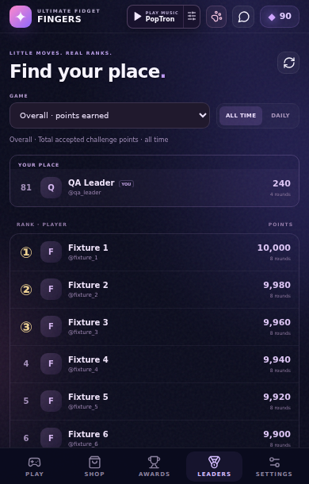
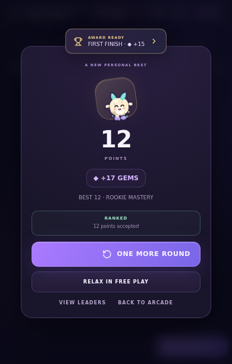
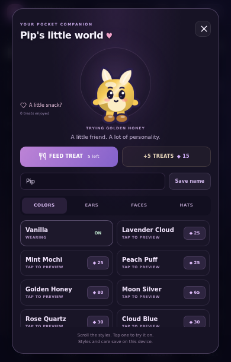
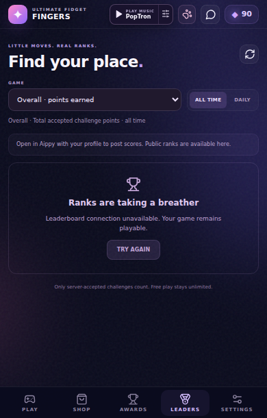

# Leaderboards frontend and Pip refinement

> Historical checkpoint. Superseded by [Pip and live leaderboards](pip-live-leaderboards-report.md). Public routing has since been repaired; Pip sizing/defaults and production profile compatibility have also been updated.

## Delivered

LEADERS is the fifth bottom-navigation destination. It presents Overall accepted point totals and individual toy single-round bests, All Time and Daily tabs, historical UTC days, server ranks, user avatars/names/usernames, pagination and a current-player card above the list even when outside the displayed top25. Filters cancel stale requests and refresh cleanly; loading, empty and unavailable states are separate. Daily rollover follows the server's metadata clock/date.

The game reads the existing Aippy user hook independently of chat admission. Starting a challenge requests a server session before starting its local clock. Unidentified/offline/failed starts remain playable as LOCAL ONLY. Positive challenge scoring events are captured with their exact kind, capped integer points and elapsed milliseconds; free play and zero-point effects are excluded. Normal 45-second and early eligible10-second rounds use the same local economy path as before.

Submitting uses the issued round ID and secret. Pending submissions persist before transmission and retain the original payload for same-account retries after reload. Concurrent retries are guarded. Network failures show AWAITING SYNC, validation failures remain local, and only an accepted response shows RANKED. The accepted response never pays Gems/XP or imports local historical scores.

Pip's wardrobe options now contain text only, retaining sample-on-name and buy/apply actions. The silhouette is subtly shorter and wider with a rounder head/body outline. Existing names, styles and care are retained.

## Tested

The final production build passed TypeScript and Vite:431.34kB JavaScript (141.57kB gzip),91.18kB CSS (20.80kB gzip). The full unit command passed68 named tests plus the sound/radio scripts. Nine leaderboard unit tests cover schema validation, malformed generic service responses, query encoding, event capture, no-profile/offline/short-round handling, payload persistence, same-secret retry, account ownership, concurrent retry suppression and final server rejection.

The focused leaderboard browser suite passed13/13 checks with mocked API transport and a local SDK profile fixture. It played real10-second eligible Pop rounds, verified the transmitted positive event trace, accepted status, submission failure/reload/retry, unchanged wallet/XP on acceptance, offline local play, cancellation of delayed start, all eight game filters, UTC history, pagination, outside-top25 current rank and mobile bounds at320,390 and430 CSS pixels. The pet control check confirms no images/canvases/SVGs inside option rows and no spending when sampling.

Fresh regression suites passed62 compact checks,20 pet checks,26 social/toy checks and44 main gameplay checks. The main suite includes an actual45-second round. Social tests explicitly isolate the new leaderboard transport so their fixture UID never posts to the public service. The production-bundle touch, atomic purchase, persistence and single-root smoke test also passed.

An exploratory challenge failure was caused by tapping a non-target Pop bubble, which correctly scored zero. The harness now plays the glowing target. Existing leaderboard fixture screenshots show fixture data and mocked acceptance, not live public rankings.

## Live service result: blocked

Actual public GET /meta, GET /rankings and OPTIONS /rounds/start return HTTP200 with the generic aippy-game-server service body and no CORS allow-origin header. A production browser fetch reports net::ERR_EMPTY_RESPONSE; the unavailable screen behaves correctly. An empty validation POST also returned the generic body. No real ranked round acceptance is claimed and no valid test score was sent to the live leaderboard.

The server follow-up is docs/leaderboards-server-followup.md, with exact public probes and required route/preflight behavior. The supplied backend authentication mode remains disabled; this frontend does not change server identity guarantees. Actual Aippy account admission and physical Android keyboard/performance/audio remain device verification work.

## Evidence

[Focused browser results](testing/leaders-browser-results.json) · [Public HTTP probe](testing/leaderboards-public-probe.json) · [Public browser probe](testing/leaderboards-live-browser.json)

