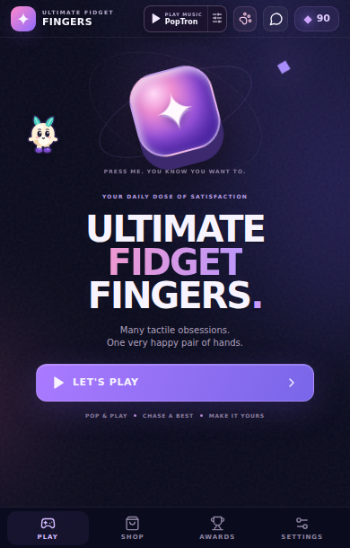
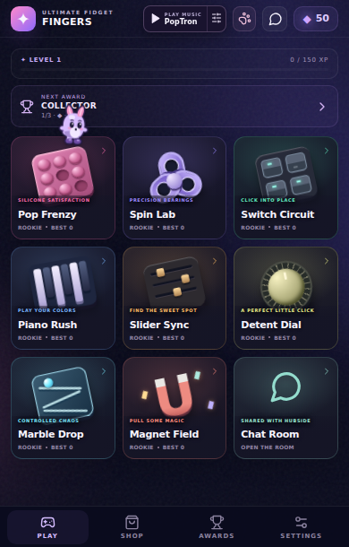
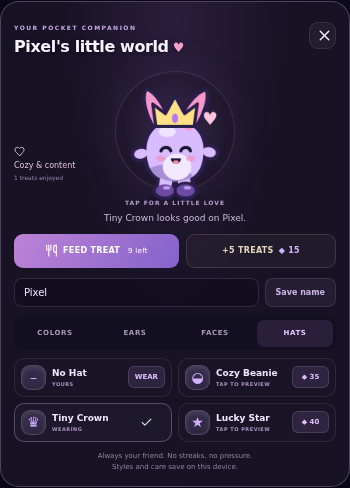

# Milo pocket pet development checkpoint

## Delivered

The user-supplied KENNEY character becomes a procedural pocket pet, retaining the original face, paws, ears, tail and plush silhouette. New independent animation instances add breathing, blinks, ear wiggles, happy tap expressions, hearts and springy hops.

Milo roams the main welcome screen before Let's Play, then hops between actual showroom card positions. Geometry follows the containing Aippy surface and scroll position. Only the small sprite target receives pointer input; the surrounding overlay passes input through. The pet hides on other pages, during toys, behind chat and behind the wardrobe. The header paw button opens the studio on every screen.

The studio provides naming, feeding, previewing and purchasing styles with the existing Gems. Four body palettes, four ear styles, three faces and four hat options include the free original appearance. Paid styles cost 20–60 Gems, equip immediately and remain owned. Five starter treats are free; five more cost 15 Gems. A short feeding cooldown prevents double consumption. Care is optional, with no absence penalties, lost possessions or challenge-score effects.

Pet state migrates into the existing validated uff-save-v2 save. Earlier saves retain their balance, XP, bests, purchases, awards, chat preferences and audio settings. The welcome wording is now “Many tactile obsessions.” In-game About and ASSET-CREDITS identify the supplied character source and Mohammad credit.

## Implementation

- src/pet/draw.ts and pose.ts adapt the supplied procedural drawing with palette, ear, face and hat variants.
- motion.ts provides bounded deterministic roaming arcs and tap reactions without game rewards.
- PetCanvas.tsx measures visible card anchors, paints independently of React state updates and cleans up frame loops and observers. It stops painting while hidden and honors both app and operating-system reduced motion.
- PetStudio.tsx and pet.css provide the compact accessible wardrobe/care dialog, keyboard focus containment and Escape/close behavior.
- state.ts owns atomic Gem transactions, validated names, inventory, equipment and care. economy.ts handles legacy-save migration.

## Verification

The final production build passed TypeScript and Vite: 406.90kB JavaScript (133.76kB gzip), 82.74kB CSS (19.11kB gzip). npm test passed 53 named tests across economy, physics, melodies, chat, pet transactions and pet motion, plus shared sound and radio checks. No new runtime dependency or remote artwork is introduced.

The fresh compact suite passed 62 checks at 320×520, 390×610 and 430×650. The fresh social suite passed 26 checks, including actual toy interactions and mocked chat/moderation. Production-bundle touch, purchase, reload persistence and single-root smoke checks passed. Exact pet browser results and evidence are retained beside this report; see pet-playtest-report.md.

Review reproduced and fixed two issues: high hops could clip ears at the top edge, and stopping keyboard propagation prevented the initial document-level Escape/focus-trap listener from running. Regression checks now cover apex bounds, Escape and Shift+Tab. Independent browser instrumentation confirmed no canvas painting after navigating away or while the document is hidden.

Exploratory pet-suite failures from tab-role, full item-name and paragraph-text selectors were corrected in the test harness. Final results distinguish actual product fixes from selector errors. No live chat message or moderation action was sent.

## Remaining verification

The actual Aippy import and physical Android performance, touch feel, haptics and sound remain unverified here. Pet care and possessions persist locally on this device, not through the future leaderboard server. The supplied character is credited as user-provided source, not described as a Kenney.nl asset license.

## Final browser evidence

The focused pet suite passed **20/20** checks, including preview pixel changes without spending/ownership changes, all three costume-category purchases, save restoration, feeding cooldown, actual showroom hopping, keyboard containment and both reduced-motion controls. Machine results: [pet-results.json](testing/pet-results.json).

