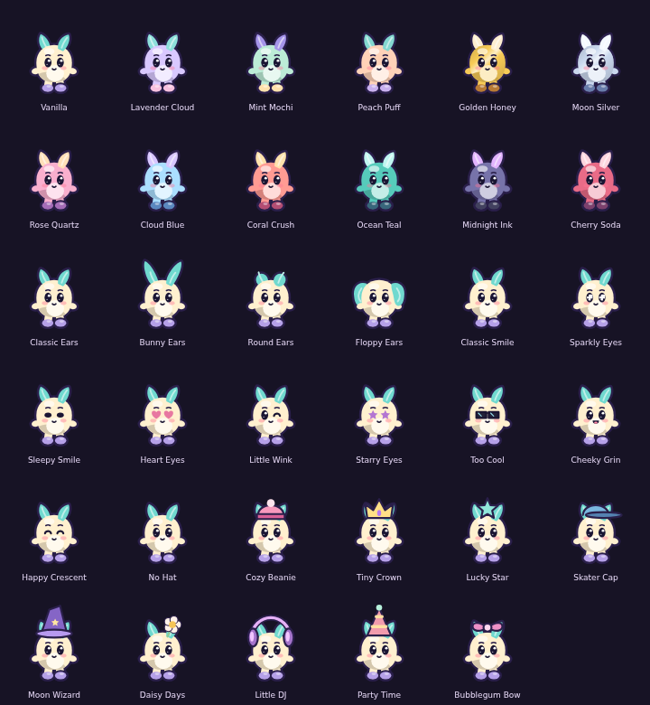
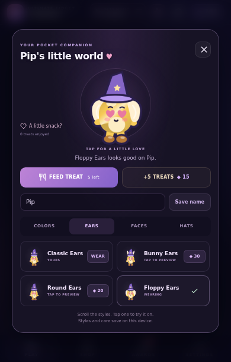
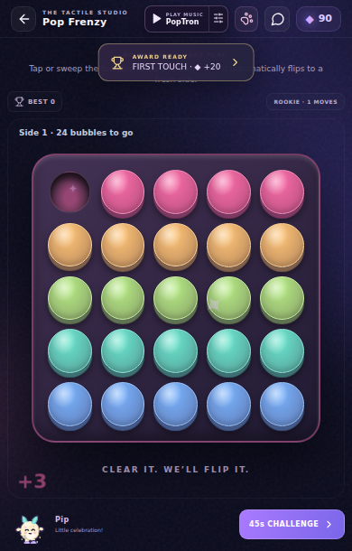

# Pip expansion and in-game companion

> Historical checkpoint. Superseded by [Pip and live leaderboards](pip-live-leaderboards-report.md). Public routing has since been repaired; Pip sizing/defaults and production profile compatibility have also been updated.

## Changes

- Default name is Pip. Existing custom names, including the supplied example Meetchu, survive migration. Explicit future renames are marked so names such as Milo can remain if intentionally chosen. Earlier unmarked automatic Milo/Mile names migrate to Pip. Vanilla and Classic Ears replace the old default wardrobe labels.
- Twelve palettes include Golden Honey and Moon Silver with metallic body gradients, plus rose, blue, coral, teal, midnight and cherry. All palette thumbnails and actual drawing use the same catalogue colours.
- Nine faces include hearts, winking, star eyes, sunglasses, cheeky and crescent smiles. Ten hat choices include a cap, wizard hat, daisy, headphones, party hat and bow alongside the existing choices.
- Floppy ears now attach at the sides of the head and mirror outward. The original geometry folded both lobes across the forehead. The corrected lobes hang outside the eye region, with matching highlights.
- Eight random tap emotes avoid consecutive repeats: wave, bounce, spin, dance, heart, peekaboo, snooze and confetti. They have distinct poses and effects. The studio shows a corresponding little message. Emotes do not generate XP, Gems or scores.
- A small passive companion sits in the lower-left game footer, below the playable board. It moves gently and responds to real scoring actions, combos, board clears, piano phrases/songs, misses, challenge starts, awards and results. Personal-best/result dialogs also show the pet reacting. Footer drawing has no pointer target and cannot intercept gameplay gestures.
- Actual character thumbnails replace generic wardrobe symbols. Style lists scroll independently so the preview and controls remain available. Reduced-motion settings continue to suppress travel and body motion.

## Verification

Production TypeScript/Vite build passed: 414.82kB JavaScript (136.32kB gzip), 84.32kB CSS (19.44kB gzip). The full unit command passed 58 named tests plus audio/radio checks. Five new tests cover default-name migration, catalogue sizes, atomic new-item purchases, outside floppy-ear geometry/shared palettes and nonrepeating emote selection/event mapping.

The focused expansion browser suite passed 11/11 checks, including actual Pop input and clear reactions, all eight game footer bounds at 320×520, 390×610 and 430×650, ten real pet taps, Golden Honey/Heart Eyes/Moon Wizard/Floppy Ears purchases and reload persistence. A static-pose contact sheet renders every catalogue option using the actual canvas renderer. Pixel checks confirm floppy-ear colour lies outside the face region.

The existing pet suite passed 20/20, compact layout suite passed 62/62 and social/toy suite passed 26/26 after selecting the marble board canvas explicitly. The companion adds a second canvas, so the old unqualified canvas selector was ambiguous; the actual marble landing behavior passes. Chat and moderation use mocked transport. Production-bundle touch pop, atomic purchase, persistence and single-root smoke checks passed.

An exploratory purchase failure came from the QA balance fixture being overwritten by the existing pagehide save flush. Seeding the isolated fixture once before app startup fixed the harness; production purchases and normal persistence were unchanged. Older unit expectations were updated for the requested default-name change.

## Remaining boundaries

Physical Android feel, audio/haptics and actual Aippy loading are unverified here. Pet state remains local to this device. The pending cumulative 12-file overlay includes the initial pet and this expansion, ready for the user's next larger import bundle.

## Evidence

[Expansion browser results](testing/pet-expanded-results.json)

