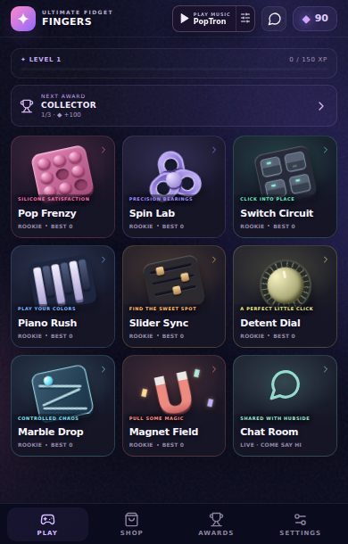
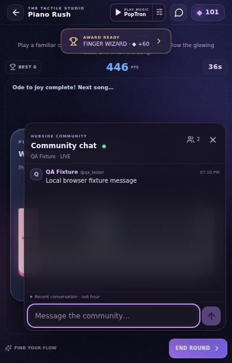
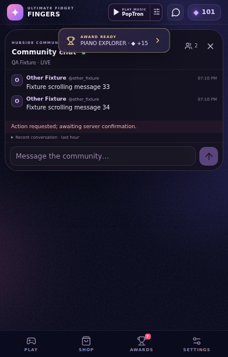
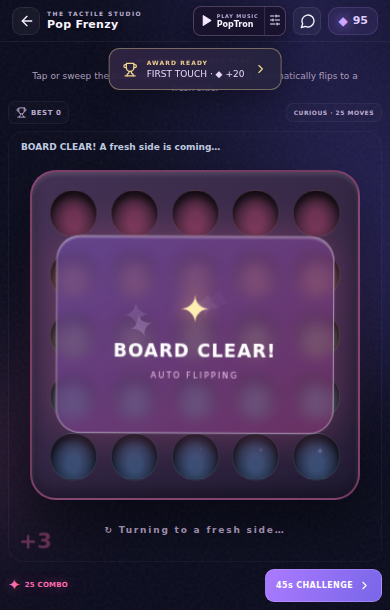
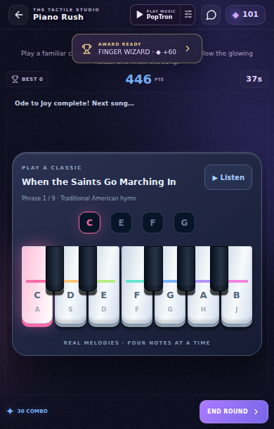
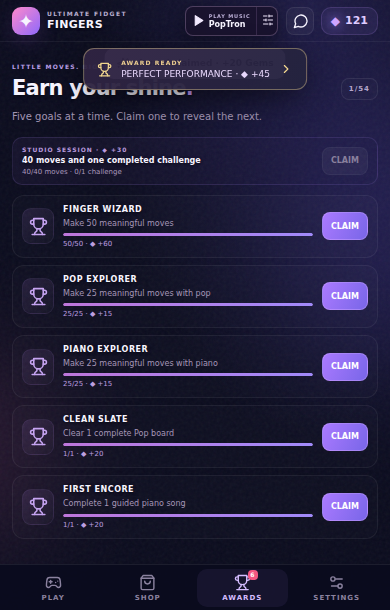

# Shared chat, music, melodies and awards update

## Delivered

- Removed the space-consuming showroom heading. Music and chat now live in the shared header on every page. Toy captions render in front of artwork while retaining the existing card shapes.
- Added a ninth showroom tile for the full chatroom and a compact translucent overlay. Both reuse the existing HubSide server, Aippy profiles and server-assigned owner moderation permissions. New messages light a red square; opening chat marks them read.
- Chat follows the newest messages and resizes against the actual embedded game surface and visual viewport. Keyboard typing does not trigger piano gameplay. Pending marble physics still completes while chat is open.
- Pop boards celebrate completion and automatically flip after 750ms; one completed side records one milestone without duplicate currency.
- Piano challenges use recognizable opening melodies of Ode to Joy, When the Saints Go Marching In and Twinkle, with four-note phrases, actual synthesized pitches, song selection and a reward-free Listen preview.
- Expanded to 54 claimable awards. Five unclaimed goals appear at a time, earned goals rise first and claiming rotates in another. Completion popups and a claim badge replace the persistent completed daily card. Claims remain idempotent.
- Fresh/default radio volume is 3%. Existing explicit volume choices and saves remain intact.

## Verification

The final integrated `npm run build` passed TypeScript and Vite, producing 384.84kB JavaScript (125.85kB gzip) and 76.62kB CSS (17.85kB gzip). `npm test` passed 17 economy, 6 physics, 6 melody/transition and 10 chat tests, plus shared-sound and radio lifecycle checks.

The compact browser suite passed 62 checks, covering portrait widths 320, 390 and 430 and the embedded game surface. The main browser suite passed 44 checks including a real 45-second challenge. The final focused social browser suite covers real Pop gestures, a complete piano melody, reward-free preview, rotating awards, SDK profile presentation, unread state, owner actions and keyboard geometry. Exact results are retained in `docs/testing/social-results.json` and `docs/social-playtest-report.md`.

A production-bundle smoke test passed: actual touch pop, immediate atomic radio purchase, persistence after reload and one React root, with no uncaught browser errors. All chat/moderation browser and unit tests use mocked transport; no test sent messages or moderation actions to the shared live room. A separate live read-only probe verified the server hello/protocol, then closed without joining.

## Findings fixed during integration

Early owner-permission/mute messages are queued until valid world admission. Mute countdowns use consistent local-clock timing. Last-hour cache expiry runs during idle and offline sessions; explicit kick/ban never automatically rejoins. Chat no longer drops legitimate delayed toy outcomes. Missing SDK identity stays read-only and opens no socket.

## Remaining boundaries

Actual Aippy import/account admission and physical Android keyboard, performance, sound and Spotify coexistence require device testing. Existing browser tests simulate visual-viewport changes rather than opening a real phone keyboard. This update adds no new Android audio-focus guarantee.

The existing server snapshot plus local cache is filtered to the last hour. A fresh device cannot recover messages the server does not return; there is no verified full-hour endpoint. Existing backend authentication mode is disabled in the reference deployment. Owner UI respects server permissions, but client changes cannot harden that backend. These limitations and exact moderation payloads are recorded in `docs/chat-integration.md`.

The larger handover target still includes Aippy/device proof and continued curation of the original 26 toys. This checkpoint implements the requested follow-up on the eight-toy build.

## Browser evidence

